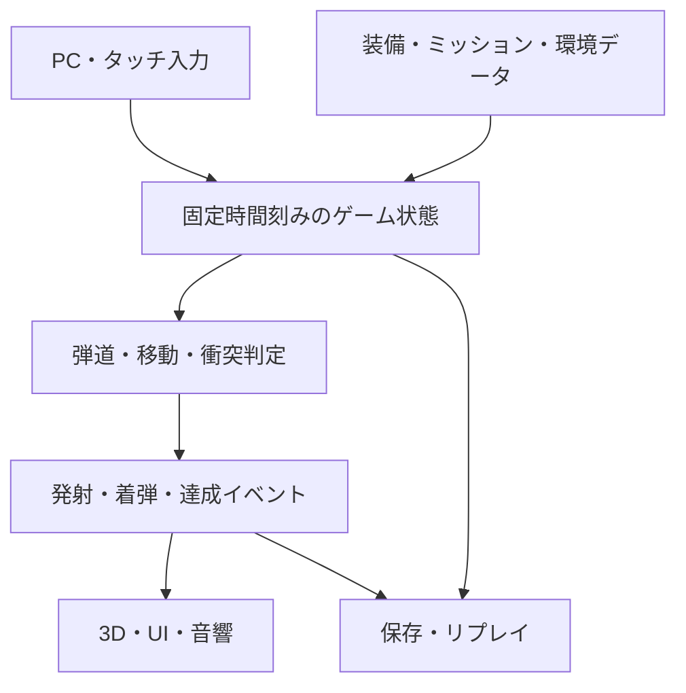
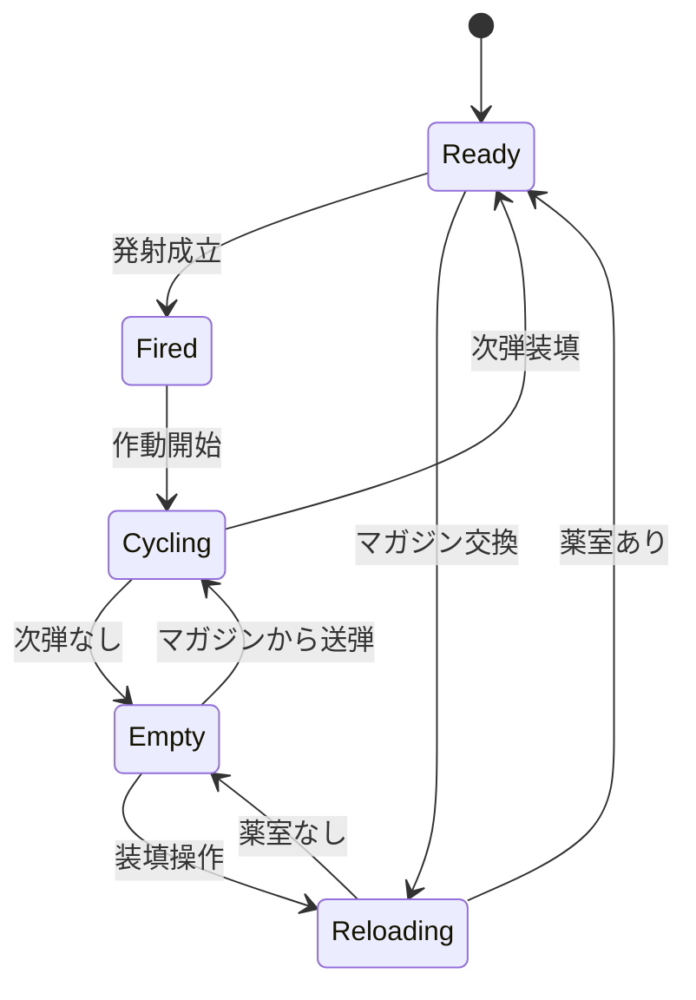

# SNIPE 技術設計・実装計画

版: 1.0 / 作成日・資料確認日: 2026-11-04 / 状態: 実装前

関連文書: [ゲーム設計書](GAME_DESIGN.md)、[README](../README.md)

本書は初版設計の記録。現在の実装範囲・採用方式・検証結果は[実装・検証記録](IMPLEMENTATION_STATUS.md)を参照する。

## 1. リポジトリの確認結果と前提

GitHubで `hellowinners861/snipe` を確認した。開始時点の公開リポジトリは空で、ブランチ一覧は空、Contents APIも空のリポジトリと応答した。既存のソース、パッケージ、AGENTS.md、モデル、音源、ビルド設定は存在しなかった。既存技術への制約はない。

本変更は設計文書だけを追加する。以下の構成、性能予算、テスト、画面は**今後実装する仕様**であり、動作確認済みのゲームを表すものではない。

### 1.1 採用判断

| 項目 | 採用 | 理由・境界 |
| --- | --- | --- |
| 言語 | TypeScript、strict設定 | 単位・データ互換・状態遷移の誤りを減らす |
| 開発・ビルド | Vite、npm、lockfile | 静的配布とローカル反復を簡潔にする |
| 3D | Babylon.js | 3Dモデル、材質、アニメーション、描画・音響をまとめて扱える [R9][R10][R13] |
| 描画基準 | WebGL 2。WebGPUは対応端末で任意 | WebGPU必須にしない。検出・初期化失敗時はWebGL 2で再生成 |
| UI | DOM/CSS + TypeScript | 日本語表示、レスポンシブ、タッチ、アクセシビリティを管理しやすい |
| 弾道 | 独立したTypeScriptの質点シミュレーター | 高速弾を描画フレームや汎用剛体の接触判定から分離 |
| 演出物理 | 初版は軽いアニメーションと減衰振動 | 排莢やゴングのために大型物理エンジンを必須化しない |
| 3D形式 | glTF 2.0 / GLB、PBR | 共通のアセット搬入形式 [R8][R9] |
| 音響 | Babylon AudioEngineV2 / Web Audio | バス・位置音・音量管理。旧AudioEngineは採用しない [R10] |
| テスト | Vitest、Playwright | 数理・状態テストとブラウザ上の一連の操作 [R16][R17] |
| 永続化 | 設定・進行はlocalStorage、リプレイはIndexedDB | 初版はサーバーなし。容量不足時もプレイは継続 |
| 配布候補 | GitHub Pages | HTML/CSS/JSとアセットの静的配布に適合 [R14][R15] |

バージョン番号をこの文書から推測して固定しない。Phase 0で互換性を確認した安定版とNodeの対応版を選び、package.jsonとlockfileへ記録する。将来のオンラインランキングやクラウド保存は別途サーバーと検証方式が必要。

## 2. 構成と責務



| モジュール | 主な責務 | 禁止する依存 |
| --- | --- | --- |
| `app` | 起動、画面遷移、読込、破棄 | 個々の弾道式を持たない |
| `simulation` | 時間、乱数種、状態更新、入力キュー | DOM、カメラ、実時間時計を参照しない |
| `ballistics` | 位置・速度の積分、空気・風のサンプリング | 難度による命中補正、描画fpsへの依存 |
| `collision` | 世界・標的との連続判定、最初の接触 | 描画LODのメッシュへ判定を依存させない |
| `weapon` | 薬室、マガジン、発射、作動、基準設定 | アニメーション終了だけで弾数を決めない |
| `aim` | 銃・照準器・眼の座標、入力感度、姿勢 | 標的中心への無条件吸着 |
| `environment` | 風場、空気密度、天候、視覚的手がかり | 毎描画フレームで物理用乱数を更新しない |
| `mission` | 配置、移動、目標、時間、得点、解放 | 表示用の文字列を判定キーにしない |
| `rendering` | Babylonシーン、カメラ、材質、モデル、VFX | 物理状態の書き換え |
| `audio` | 音源、バス、到達時刻、環境の反響 | 得点を音声イベントから算出しない |
| `ui` | 情報表示、入力設定、画面遷移要求 | 物理データを表示の都合で変更しない |
| `persistence` | セーブ移行、容量制御、リプレイ保存 | 生の保存値を検証せず実行しない |

想定ファイルは `src/app/`、`src/simulation/`、`src/ballistics/`、`src/collision/`、`src/weapon/`、`src/aim/`、`src/environment/`、`src/mission/`、`src/rendering/`、`src/audio/`、`src/ui/`、`src/persistence/`、`src/data/`。アセットは `public/assets/`、検証は `tests/unit/`、`tests/integration/`、`tests/e2e/` に置く。これらのフォルダは実装時に作成する。

## 3. 座標系・単位・時計

### 3.1 座標と単位

- 世界座標は左手系、+Xが右、+Yが上、+Zが射場の基準前方。銃のローカル前方も+Zとする。
- 世界の1単位を1mとする。時間s、速度m/s、質量kg、力N、エネルギーJ。
- 重力は `g = (0, -9.80665, 0)` m/s²。視線が上や下を向いても回転しない。
- 角度の内部単位はrad。UI境界で度、mrad、MOAへ変換する。
- `1 mrad = 0.001 rad`、`1 MOA = π / (180 × 60) rad`。単位の混在を型・変換関数で封じる。
- glTF搬入時の座標変換はローダー／アセット境界で1回だけ行い、左右の反転を重複させない。
- シミュレーションはJavaScriptの倍精度数値を使う。描画のFloat32へ渡す境界を分ける。

### 3.2 固定時間刻み

初期案は1/240秒の固定ステップ、弾道積分はRK4。標的移動・風・発射・制限時間は同一のシミュレーション時刻を使う。描画は補間する。

1. 入力をタイムスタンプ付きでキューに格納し、次の固定ステップで適用する。
2. 発射成立なら、そのステップの発射姿勢を確定する。
3. 標的の開始・終了姿勢を求め、弾の区間を積分し連続衝突判定する。
4. ステップ内の衝突時刻を求め、時刻順に一度だけイベントを発行する。
5. ミッション達成と締切を、整数tick＋ステップ内の時刻で比較する。
6. 確定状態から描画・音響用イベントを送る。

30/60/120/144fpsで同じ入力履歴から同じ結果が得られることを検証する。精度は1/120・1/240・1/480秒の収束試験で確認し、1/240秒という値だけを根拠に十分と判断しない。

追いつき更新は1描画につき原則12ステップまで。残りの時間は蓄積し、黙って捨てない。250ms以上の滞留やタブ非表示では自動停止して入力を解除し、再開時に実時間からの大きな差分を加算しない。低負荷化は描画から行い、飛翔中に物理精度を下げない。

## 4. 弾道モデル

### 4.1 基本式

弾を質点として扱う。位置を `p`、世界速度を `v`、その位置・時刻の空気の速度を `w(p,t)`、相対速度を `u = v - w` とする。

```math
\frac{d\mathbf p}{dt} = \mathbf v
```

```math
\frac{d\mathbf v}{dt} = \mathbf g
-\frac{\rho C_d(M) A}{2m}\lVert\mathbf u\rVert\mathbf u
```

`ρ` は空気密度、`A` は抵抗係数の定義と対応した基準面積、`m` は質量、`M = |u| / c_air` は相対速度に基づくマッハ数。抵抗は空気との相対運動に逆向きに働く。[R1][R2]

- `Cd(M)` は架空弾薬ごとの非負の抵抗曲線。範囲外の扱いは端点固定とし、検証対象速度域からの逸脱をログに残す。
- 基準面積と抵抗曲線は一組のデータとして保持する。別の定義の係数をそのまま混ぜない。
- G1/G7のBCとこの`Cd`方式は別の表現。BC値を`Cd`として直接代入しない。初版は`Cd`方式に統一する。
- 風を「毎秒横へ一定量ずらす」「難度に応じた横加速度を加える」処理へ置き換えない。
- `|u|` が十分小さいときは抵抗を0として扱い、方向の正規化によるゼロ除算を防ぐ。
- 各RK4評価点で位置・時刻に応じた風と空気密度を参照する。
- 出現時に1回だけ速度・発射方向のばらつきを抽選する。飛翔中にランダムな方向変更を加えない。

弾道データは架空のゲーム用。実在弾薬の装薬条件、実射補正表、貫通性能表はデータ仕様に含めない。必要な初期速度・質量・基準面積・曲線の具体値はPhase 0の架空プロファイル校正で確定し、根拠とバージョンを記録する。

### 4.2 大気・風・高低差

| 要素 | MVP | 完成版 |
| --- | --- | --- |
| 空気密度 | 環境ごとに固定した値 | 気温・気圧と整合した乾燥空気近似。湿度の詳細は後続 |
| 音速 | 共通の環境定数 | 温度に対応した値を物理・音響で共用 [R11] |
| 風 | 無風・一様な3Dベクトル | 基本風＋滑らかな空間成分＋時間変化 |
| 突風 | なし | 種から生成した連続変化。瞬間的な不連続を避ける |
| 高低差 | 3D配置と一定重力 | 同じモデルを使用 |
| 地形による流れ | 射場設定として指定 | 地域別の風場を手作業で配置。流体解析と称さない |

風場は連続的に補間し、局所ゾーンの境界で急に逆転しない。旗は各旗の位置、風速計は観測器の位置、弾は弾の位置の風を参照する。風向表示の「吹いていく方向」と、方位の定義をデータ・UIで統一する。

高低差に対して別の経験的な落下係数を掛けない。視線距離、水平距離、高さの差を別に求め、UIの距離表示と衝突する3D座標を一致させる。

### 4.3 再現範囲と限界

| 現象 | 方針 |
| --- | --- |
| 重力、空気抵抗、飛翔時間、3D風、移動標的 | 初版の中核として再現 |
| 速度による抵抗の変化 | `Cd(M)`で近似。実弾の実測曲線を名乗らない |
| 光軸と銃口の位置差、傾き | 別座標と回転で再現 |
| 呼吸、眼位置、反動 | ゲーム用の運動・視覚モデルとして近似 |
| 湿度の詳細、回転による偏り、地球自転、空力ジャンプ | 初版は省略。将来は誤差とプレイ上の効果を確認して追加 |
| 銃身内の燃焼、弾の変形、6自由度姿勢 | 対象外 |
| 材質別の実際の貫通・跳弾 | 対象外。最初の接触で弾を終了 |

これは「主要な外部弾道を使ったゲーム」であり、実銃の全現象を再現する装置ではない。将来項目の追加より先に、初版の照準・着弾・リプレイの整合性を確保する。

## 5. 照準・スコープの数理と状態

### 5.1 変換を一本化する

`AimState` は銃本体の姿勢、照準器の取付変換、上下・左右のダイヤル、銃の傾き、眼位置、呼吸状態、倍率を保持する。

- 銃身の世界方向とスコープの光軸は同一変数にしない。
- ダイヤルは銃身に対する照準軸の角度関係を変更する。照準画像に反映し、弾への架空の力は発生させない。
- 基準設定は `(rifleId, ammoId, scopeId)` に対応する取付・角度の組。装備変更時に異なる設定を流用しない。
- 基準設定は、ゲーム内の無風・規定環境・静止標的で検証する。プレイヤー向けの実銃校正手順には展開しない。
- カントは銃身軸まわりの回転として、照準器のオフセットと調整軸にも反映する。重力は回さない。
- 発射時は**銃口の世界位置**から、確定した銃身方向へ弾を生成する。カメラ中心のレイを弾の代わりに使わない。
- カメラでは見えていても銃口前に障害物があれば、手前で衝突する。
- 見た目用の一人称銃を別シーンで描く場合も、正規の物理用銃口座標を唯一の基準とする。

上下・左右のUIの符号は、基準条件でレティクルを標的へ合わせ直した後に着弾が表示方向へ動くことをテストする。実装都合のEuler角の正負をそのままユーザーへ出さない。

### 5.2 倍率とレティクル

倍率`M`、基準の垂直視野角`FOV1`に対し、初期近似は `FOV(M) = 2 atan(tan(FOV1/2) / M)` とする。度数のFOVを倍率で単純に割る実装にはしない。最終的な見え方はゲーム内スコープごとの表示校正で確認する。

FFPでは角度目盛りを現在の射影から画面座標へ変換し、標的像と整合させる。SFPは画面上の大きさを固定し、規定倍率での目盛りとの対応を定義する。倍率変更で弾道・散布・残弾を変えない。[R5]

マウス／ドラッグの移動量は既に移動差分なので、さらにフレーム時間を掛けない。ゲームパッドや仮想スティックの回転速度だけに時間を掛ける。スコープ倍率別感度は入力層で一度だけ適用する。

### 5.3 視差・ピント・眼位置

完全なレンズ光線追跡は行わない。標的距離と設定距離の差からピント表現を作り、眼位置のずれがある場合に照準像の相対変位を加える近似を使う。[R3][R4]

- 眼が中心にある場合、ピントが合っていなくても無条件のランダム照準ずれは加えない。
- 視差の変位はレティクルと標的像の関係に作用し、飛翔中の弾には作用しない。
- 自動センタリングでは眼位置を固定。手動設定は完成版の上級操作に限定する。
- 低画質でぼかし効果を落としても、ピント状態の表示と角度関係を保持する。

## 6. 衝突・標的・着弾判定

### 6.1 高速弾のすり抜け防止

1ステップ後の点だけで接触を調べない。弾の前後位置を結ぶ区間を使い、曲率が許容値を超える場合は局所的に区間を細分化する。

- 地面・岩・構造物: 専用の簡略化衝突形状と区間交差。空間索引で候補を絞る。
- 薄い標的: 薄さに依存しない面・円盤・箱の判定を使い、交差点を標的ローカルへ変換する。
- 移動標的: 弾と標的の同じ時間区間で相対運動を解く。MVPのレール移動は並進の解析形を優先する。
- 折返し・回転: 折返し時刻で区間を割り、回転を含む場合は保守的な境界で候補を取り、時刻探索で接触を確定する。
- 遮蔽物と標的が同一ステップで交差した場合、最小の接触時刻だけを採用する。
- 接触時刻までの速度を求め、その値で反応を計算する。ステップ末尾の速度を流用しない。

弾の衝突半径をデータに持つが、アシストやタッチ操作で密かに拡大しない。入門の難度を下げる場合は見た目と判定の両方の標的を大きくする。

### 6.2 標的の状態

`inactive → active → hit → completed` を基本とする。採点要求が複数ある標的では、命中イベントのIDと有効な採点枠を保持する。移動は時間関数／スプラインと種で定義し、描画だけで動かさない。

- `ImpactEvent` は弾ID、標的ID、絶対時刻、位置、法線、着弾速度、標的ローカル座標を持つ。
- 同一イベントIDの再適用は無視し、スコア・音・VFXの重複を防ぐ。
- 運動エネルギー `E = m|v|²/2` と運動量 `q = mv` は別に記録する。
- 機械式標的はゲーム独自の`responseThreshold`と弾薬の反応プロファイルを使う。実材の貫通計算に流用しない。
- エフェクトの破片・排莢は採点や弾道へ干渉しない。
- 弾は衝突、定義された領域外、最大寿命のいずれかで終了。プールへ返し、上限で既存の飛翔を黙って消さない。

## 7. 発射・装填の状態機械



図は主状態のみ。`weaponAction`、薬室、マガジン、予備弾、次に発射できる時刻は別フィールドとする。ボルト手動設定では`Fired`で操作を待つ。セミオートは自動で`Cycling`へ進むが、次の発射には新しい押下入力が必要。

- 薬室の1発とマガジン内の弾数を区別する。
- 薬室が空でもマガジンに弾がある場合、送弾操作で`Cycling`へ進める。自動操作設定ではその遷移を自動実行する。
- 発射受付はReady、薬室あり、ミッション稼働中、UI未操作のすべてを満たすときだけ。
- 入力を押し続けて一時停止・再開しても勝手に発射しない。
- 作動時間はシミュレーションのデータで決め、アニメーションをそれに同期する。
- MVPでは装填中の発射や装備変更を禁止し、キャンセル分岐を増やさない。
- 弾数の変更は状態遷移時に一度だけ。映像の再生・停止では弾を増減しない。

## 8. データ設計

装備・ミッションはID参照で結合する。単位をフィールド名に含め、起動時のスキーマ検証とビルド時の参照検査を行う。

| データ | 主要フィールド |
| --- | --- |
| `RifleDefinition` | `id`, `action`, `compatibleFamilies`, `modelId`, `scopeMount`, `muzzleAnchor`, `capacity`, `cycleSeconds`, `reloadSeconds`, `swayProfileId`, `recoilProfileId` |
| `AmmoDefinition` | `id`, `family`, `property`, `massKg`, `muzzleSpeedMps`, `speedSigmaMps`, `referenceAreaM2`, `dragCurveId`, `dispersionRad`, `collisionRadiusM`, `reactionProfileId` |
| `ScopeDefinition` | `id`, `focalPlane`, `magnificationMin/Max`, `referenceMagnification`, `clickRad`, `elevationLimitsRad`, `windageLimitsRad`, `reticleId`, `modelId` |
| `ZeroProfile` | `rifleId`, `ammoId`, `scopeId`, `referenceEnvironmentId`, `mountTranslationM`, `sightRotationRad`, `version` |
| `EnvironmentDefinition` | `id`, `airDensityKgM3`, `soundSpeedMps`, `windFieldId`, `visibility`, `lightingPreset`, `audioPreset` |
| `TargetDefinition` | `id`, `modelId`, `collider`, `scoreZones`, `motionId`, `responseThreshold`, `materialSoundId` |
| `MissionDefinition` | `id`, `version`, `mapId`, `spawnPose`, `seed`, `environmentId`, `targets`, `allowedLoadouts`, `roundLimit`, `timeLimitSeconds`, `objectives`, `unlockIds` |
| `ShotRecord` | `shotId`, `tick`, `loadoutIds`, `aimSnapshot`, `initialVelocity`, `seed`, `trajectory`, `impact`, `contentVersion`, `simulationVersion` |
| `SaveData` | `schemaVersion`, `settings`, `missionProgress`, `unlocks`, `personalBests`, `replayIndex` |

初期値を入れる順序は、架空の弾道プロファイル→基準設定→標的配置→弾数・制限時間→得点の順。装備の比較バーから物理数値を逆算しない。実在製品と一致する性能値を集めることを実装の前提にしない。

### 8.1 データ検証

- 質量・基準面積・速度・クリック幅が正、抵抗係数が非負、数値が有限。
- ID参照がすべて解決し、銃・弾・スコープの組に基準設定がある。
- 対応弾薬以外を持ち込めず、持ち込み弾数はミッション上限以下。
- ミッションの必須標的数と採点枠、移動経路、作動閾値に矛盾がない。
- 制限時間は目標配置・飛翔・装填を含めて達成可能。
- MVPに存在しない解放先は「今後追加」と明示して選択不可にする。未実装ファイルへ遷移させない。
- 得点はゲーム設計書の式と同じ関数を表示・判定の両方で使う。

## 9. 3Dアセットの契約

### 9.1 搬入仕様

モデルはメートル単位、地面はY=0、前方はゲーム搬入後+Z。ライフル原点はストック側の定めた取付点へ統一し、ルートのスケールは正規化する。GLBの搬入テストで実際の寸法と左右を確認する。[R8][R9]

| 種別 | 必須ノード・データ |
| --- | --- |
| ライフル | `root`, `muzzle`, `scope_mount`, `ejection_port`, `grip_r`, `grip_l`, `bolt`, `magazine` |
| スコープ | `optic_root`, `eye_point`, `lens_front`, `lens_rear`, `turret_elevation`, `turret_windage`, `zoom_ring` |
| 手 | 共通スケルトン、左右の手首と握りの調整点 |
| 標的 | `target_root`, `hit_surface`, `reaction_pivot`、表示用メッシュと別の衝突定義 |
| 射場 | 射座、標的設置点、風旗位置、衝突形状、遠景LOD |

共通アニメーション名は `idle`、`aim_in`、`aim_out`、`fire`、`cycle`、`reload`、`empty`、`inspect`。存在しない操作には明示的な代替を設定する。セミオートに長い手動ボルト動作を流用しない。

### 9.2 初期の性能予算

次は実測値ではなく制作上の上限目安。Phase 1で実機測定して見直す。

| 項目 | PC標準 | モバイル低画質 |
| --- | --- | --- |
| 画面更新 | 1080p相当で60fps目標 | 内部解像度を調整して30fps以上目標 |
| 一人称ライフル | 1丁あたり約4万三角形以内 | LODで約2万以内 |
| 全描画三角形 | 約60万以内 | 約20万以内 |
| 描画コール | 約180以内 | 約100以内 |
| テクスチャ | 主役2K、その他1K中心 | 主役1K、その他512〜1K中心 |
| スコープ | 必要な対象だけ描く追加パス | 単一パスの代替方式 |
| 影・草・粒子 | 距離・数に上限 | 影解像度、草、粒子から縮小 |

配信サイズの初期目標は、最初のプレイに必要なJS・モデル・音源を合計25MB以内、MVP全体80MB以内。後続ミッションの大きな素材は先読みまたは遅延読み込みする。共有モデルや音源は重複保存しない。

画質設定で物理刻み、標的の当たり判定、視線距離、時間制限を変えない。LODの判定にはスコープの拡大を考慮し、覗いた途端に的が粗く消える問題を防ぐ。遠景の非重要な装飾と、遮蔽物を区別する。

### 9.3 制作・権利・検収

最初のモデルと音源は、自作または利用条件が確認できる素材から用意する。購入費が発生する場合は無料案と候補を比較してから判断する。本設計時点で素材を購入・取得した事実はない。

`assets/manifest.json` にID、相対パス、種類、内容ハッシュ、容量、LOD、作者、出典URL、ライセンス、変更内容を記録し、`THIRD_PARTY_NOTICES.md` を生成する。Web配布ではデータが利用者へ渡るため、見た目を使える許可だけでなくモデル・音源の配布条件を確認する。

検収は、GLBを読み込めること、必要ノード、寸法、材質、法線、透明度、アニメーション、手との接触、スコープ位置、衝突形状の対応を確認する。外部URLへのホットリンクで完成扱いにしない。

## 10. 音響の実装

`AudioEngineV2`を採用し、Masterの下にMusic / Weapon / Environment / UIを置く。音源取得と発音を分離し、発射直前にネットワーク読み込みが起きないようにする。[R10]

- タイトルの開始操作内で音声を有効化する。自動再生が拒否されたら、無音で進められる明示ボタンを出す。[R12]
- BGMはループ区間を整え、場面と残時間でクロスフェードする。停止・再開で二重再生しない。
- 到達待ちの音はゲーム時刻で管理し、再生直前に音声時計へ変換する。一時停止中は待ち時間も止め、予約済みの音を破棄・再予約して再開時の重複を防ぐ。
- 発射音はプレイヤーの近くで即時。着弾音は`着弾時刻 + 着弾点から耳までの距離 / c_air`を初期近似の到達時刻とする。[R11]
- MVPは固定射座なので、発音位置と耳の距離をイベント時に求める。後続で移動する場合は音の到達モデルを別途見直す。
- 遮蔽は音量と高域の簡易フィルタ、反響は射場プリセットで近似する。音線追跡とは呼ばない。
- 超音速の衝撃音は全発射へ一律に付けない。必要になる観察視点と物理状態を定義できてから追加する。
- 同時発音数はモバイル24、PC48を初期上限とし、遠い装飾音から抑える。自分の発射・操作音を優先する。
- 音用乱数は弾道乱数と別系列。音の設定で着弾結果を変えない。
- iOSなどの音声中断・復帰では明示操作で再開できるようにする。アプリ切替中は音を停止する。

## 11. 保存・リプレイ・再現性

設定は値域を検証したJSONとして保存し、進行には`schemaVersion`を付ける。旧版からの移行が失敗しても起動を妨げず、設定だけ初期化する選択肢を示す。書き込み例外ではセッション内に保持してプレイを続ける。

リプレイは最大20件または合計20MBの小さい方を初期上限とする。軌跡は表示用に間引いて保存し、発射点・最接近点・着弾点・イベント時刻は必ず残す。

- 乱数系列: 風、弾の散布、標的、音、視覚効果を分離する。
- 同一ビルド・同一種・同一入力からの再実行は許容誤差内で一致することを保証する。
- 異なるブラウザ間の浮動小数点まで完全一致するとは主張しない。表示は保存済み軌跡を使える。
- 設計変更で同じ種の結果が変わりうるため、`simulationVersion`と装備・環境の内容バージョンを記録する。
- 旧リプレイは軌跡表示を維持し、互換性のない新版で勝手に再採点しない。
- オンライン検証を持たないため、ローカルの得点を改ざん耐性のある世界ランキングとして扱わない。

## 12. 入力・画面・端末対応

UIの操作と照準操作は入力コンテキストで分ける。調整パネルを押した指が、同時に視点変更や発射として処理されないようにする。

- PCはPointer Lockの取得を明示操作に結び付け、解除されたら一時停止する。
- タッチはpointerIdごとに担当操作を固定し、cancel時に必ず解除する。
- 発射ボタンを押したまま指が外れた場合、再進入だけで追加発射しない。
- セーフエリアを避け、主要タッチ領域は48 CSS px以上を初期目標にする。
- 縦画面は説明と横向き案内を出し、非対応の向きで射撃を続けない。画面回転の強制成功を前提にしない。
- 読込、フォーカス喪失、GPUコンテキスト喪失時は入力を止める。
- 必須モデルが欠落した場合はエラーと再読込を表示。完成版で箱の銃へ黙って置き換えない。
- 高倍率で感度を下げられ、スコープ揺れ・反動の画面演出・点滅を個別に弱められる。
- 見やすさの変更は物理結果へ影響させない。揺れ自体を物理的に減らす補助はアシスト使用として記録する。

## 13. 性能測定と配布

CPU時間を入力、物理、衝突、描画準備に分け、GPUは可能な環境で測定する。平均fpsだけでなくフレーム時間p95、初回読込、メモリ増加、5〜10分連続動作、スコープ切替時の停止を確認する。

最低限の実機確認対象はWindowsのChrome/Edge、iPhone/iPadのSafari、AndroidのChrome。自動化のWebKitやモバイルエミュレーションだけでiOSの実機対応を完了としない。対応機種・OS・ブラウザのバージョンを測定記録に残す。

GitHub Pagesを使う場合、Viteの`base`はプロジェクトパス `/snipe/` に設定する。モデル・音源・デコーダーを含めて基準パスから読み込み、ルート`/assets/`を決め打ちしない。画面遷移はハッシュまたは単一URLの内部状態で行い、再読込の404を避ける。[R14][R15]

実装時にCIへ型検査、データ参照検査、単体テスト、ビルド、主要E2Eを追加する。公開先の作成・有効化・デプロイは本設計作成の範囲外。

## 14. 実装の段階と完了条件

段階は依存順。日数は開発体制・アセット確保が未定のため断定しない。各段階の出口を満たしてから次へ進む。

| 段階 | 実装内容 | 出口条件 |
| --- | --- | --- |
| P0 土台と数理 | TS/Vite/Babylon、座標、固定時計、架空弾道、風、衝突、入力骨格 | 解析解・収束・すり抜け検証が通る。使う依存版を固定 |
| P1 一連のプレイ | 1射場、M01、3Dライフルと手、スコープ、音、結果、再挑戦 | 仮箱を卒業した3Dモデル、BGM、発射・着弾音で1ミッション完走 |
| P2 装備と照準 | Ranger/Sentinel、標準/精密、2スコープ、ダイヤル、基準設定、装填 | 装備変更が見た目・作動・飛翔に反映。互換と符号の検証完了 |
| P3 MVP内容 | M02〜06、移動、一様風、高低差、採点、進行保存、タッチUI | 6ミッションをPC・スマホでクリア。条件違いの自己ベストを分離 |
| P4 完成版内容 | 4ライフル、5弾薬特性、M07〜12、追加射場、変化する風 | 全装備の役割と全ミッションの到達可能性を確認 |
| P5 調整と仕上げ | 上級光学、リプレイ、音響、実機最適化、素材台帳 | 受入表の対象項目、実機、権利表記、読込失敗への対応が完了 |

P1までを最初の動作確認可能な単位とする。P3をMVP、P5を1.0の完成と呼ぶ。P3の時点で手動視差や未実装の装備を使えるようには表示しない。

### 14.1 実装時のチケット候補

| ID | 作業 | 依存 | 優先 |
| --- | --- | --- | --- |
| T01 | アプリ起動・3Dシーン・ローディング・PC/タッチ入力 | なし | 必須 |
| T02 | 固定時間、乱数系列、質点弾道、基本検証 | T01 | 必須 |
| T03 | 世界・静止標的の連続衝突、イベント | T02 | 必須 |
| T04 | 銃と照準器の変換、銃口、倍率、レティクル | T01、T02 | 必須 |
| T05 | 3Dモデル搬入、手、発射・装填アニメーション | T04 | 必須 |
| T06 | BGM、発射、操作、遅延着弾音、音量保存 | T03、T05 | 必須 |
| T07 | M01の選択〜結果、再挑戦 | T03〜T06 | 必須 |
| T08 | 装備データ、互換、上下左右、基準設定 | T07 | 必須 |
| T09 | 移動標的、一様風、高低差、M02〜06 | T08 | 必須 |
| T10 | スコア、進行保存、端末別UI、MVP実機確認 | T09 | 必須 |
| T11 | Kestrel/Atlas、残り弾薬、追加射場とM07〜12 | T10 | 1.0必須 |
| T12 | 空間・時間変化する風、上級光学、リプレイ完成 | T11 | 1.0必須 |
| T13 | 性能、素材台帳、全ミッション調整、配布ビルド確認 | T12 | 1.0必須 |

これは作業分解案であり、GitHub Issueを作成した記録ではない。

## 15. 検証・受入条件

以下は**将来の実装に対する要求**。設計書作成時点ではゲームコードもテスト結果も存在しない。

| ID | 対象 | 検証と合格条件 |
| --- | --- | --- |
| A01 | 無抵抗の弾道 | `p(t)=p0+v0t+gt²/2`の解析解と5秒区間で位置誤差1mm以内 |
| A02 | 抵抗 | 無風で運動＋位置エネルギーが許容誤差を超えて増加しない。風ありでは同条件を誤適用しない |
| A03 | 数値収束 | 1/240と1/480秒の着弾差が10mmまたは最小得点域幅の2%の小さい方以内。満たさなければ刻み・区間分割を再設計 |
| A04 | 描画独立 | 同じ入力履歴を30/60/120/144fpsで再生し、得点・命中IDが同じ、着弾差1mm以内 |
| A05 | 連続衝突 | 1ステップで薄い的を越えるケース、移動する的、折返し、手前の壁で最初の衝突だけを検出 |
| A06 | 風 | 対称な左右風で横変位が符号反転。旗・風速計・弾が同じ場を位置別に参照 |
| A07 | 高低差 | 座標だけを変えた上・下の配置で重力が世界の下向きのまま。距離表示も一致 |
| A08 | 照準 | 上下左右の符号、基準への復帰、銃口の位置差、壁際、カントを既知の仮想配置で確認 |
| A09 | 光学 | FFPの角度目盛りが倍率を変えて一致。SFPは規定倍率のみ一致。倍率が弾道を変えない |
| A10 | 発射・装填 | 空撃ち、連打、長押し、手動ボルト、マガジン交換、停止復帰で弾数が保存される |
| A11 | 制限時間 | 締切直前・同時・直後の着弾、最後の弾が飛翔中の状態を正しく扱う |
| A12 | 採点 | 未達枠、重複命中、無制限課題、標的作動不足、0発でNaNや二重得点が出ない |
| A13 | リプレイ | 同一ビルドで記録結果が許容誤差内に再現。別版では互換性表示を出す |
| A14 | 音 | 開始操作で再生、音量保存、遠方着弾の遅れ、中断復帰、二重BGMなし |
| A15 | タッチ | ドラッグ・発射・倍率・息止めの同時操作、pointer cancel、横画面、セーフエリア |
| A16 | 3D素材 | 名前付きノード、アニメーション、寸法、標的の見た目と判定、低画質LODを確認 |
| A17 | 保存 | 旧版、破損JSON、容量不足、保存禁止環境でも起動とプレイを維持 |
| A18 | 性能 | 対象実機で目標fpsを確認し、10分プレイ・ミッション切替で単調なメモリ増加なし |
| A19 | 配布 | `/snipe/`配下でJS・GLB・音源・デコーダーを読込。再読込と読込失敗の案内を確認 |
| A20 | プレイ成立 | 全ミッションを許可装備・各プリセットでクリア。推奨装備が入手済み、金評価が到達可能 |

数理・装填・採点はVitestで、画面導線と基本入力はPlaywrightで検証する。音の気持ちよさ、細かなタッチ操作、実機の発熱・視認性は人のプレイで確認する。[R16][R17]

## 16. 主なリスクと判断方針

| リスク | 対応 |
| --- | --- |
| 写実性の項目が増え完成しない | P3を明確なMVPに固定。追加物理より1ミッションの完成を先にする |
| スコープの二重描画がスマホで重い | 単一パスの代替をP1で試し、標的と照準の精度を維持する |
| 動く標的にすり抜ける | 固定刻みだけに頼らず、時間を含めた連続判定を作る |
| 風と散布の区別が付かず不公平に感じる | 導入段階は散布を小さくし、風の手がかりとリプレイを用意 |
| タッチが高倍率で操作困難 | 倍率別感度、微調整、発射ボタンの分離、実機での調整 |
| 銃・弾を変えても見た目以外が同じ | 作動、音、散布、反動、抵抗、持ち込み制約で役割を比較 |
| 強い銃だけが正解になる | 小さい紙標的、移動ウィンドウ、弾数、構え直し速度で用途を分ける |
| 外部素材の配布条件が不足 | 素材選定時に台帳と配布条件を確認し、後付けの置換を避ける |
| 仕様と実装が離れる | 各段階のPRで対象仕様と受入IDを記載。数値変更はデータと文書を同時更新 |

## 17. 参考資料と本設計への適用

資料確認日: 2026-11-04。以下は一次資料・公式文書。製品の宣伝上の精度や到達距離をゲームの検証根拠には使わない。照準・物理の一般原理を確認した上で、操作、難度、性能予算、架空装備の数値、得点、ミッションは本設計の判断として定めた。

| ID | 一次資料 | 確認内容・採用範囲 |
| --- | --- | --- |
| R1 | [NASA — Drag Equation](https://www1.grc.nasa.gov/beginners-guide-to-aeronautics/drag-equation/) | 抵抗の基本式、密度・相対速度・面積・係数の関係。弾薬曲線そのものの提供資料ではない |
| R2 | [NASA — Factors that Affect Drag](https://www1.grc.nasa.gov/beginners-guide-to-aeronautics/factors-that-affect-drag/) | 空気との相対速度、形状、圧縮性を含む影響 |
| R3 | [Leupold — Understanding the Numbers on Your Riflescope](https://www.leupold.com/blog/post/understanding-the-numbers-on-your-riflescope) | 上下・左右の調整、角度単位、視差の概念 |
| R4 | [Leupold — Riflescope Owner’s Manual](https://www.leupold.com/media/manuals/riflescope-instruction-manual.pdf) | 倍率、視度、基準設定、調整ダイヤル、眼位置と視差を別機能として整理 |
| R5 | [DEON / March — Classification of March Rifle Scopes](https://marchscopes.com/column/classification-of-march-rifle-scopes/) | FFPとSFPの拡大・目盛りの違い |
| R6 | [Ruger — Precision Rifle Overview](https://ruger.com/products/precisionRifle/overview.html) / [製品更新の公式発表](https://ruger.com/news/2024-12-19.html) | ボルトアクション、調整式ストックなどの構成参考。製品性能は転記しない |
| R7 | [CZ — CZ 457 Carbon公式発表](https://www.czfirearms.com/en-us/news/cz-introduces-the-cz-457-carbon-rimfire-rifle-the-first-cz-firearm-with-a-carbon-fiber-wrapped-barrel) | 小型・軽量のボルトアクションという役割と外観の参考 |
| R8 | [Khronos — glTF](https://www.khronos.org/gltf/) | ランタイム向け3Dアセット形式 |
| R9 | [Babylon.js — glTF Loader](https://doc.babylonjs.com/features/featuresDeepDive/importers/glTF/) | glTF 2.0とローダー、製品配信の方針 |
| R10 | [Babylon.js — Audio](https://doc.babylonjs.com/features/featuresDeepDive/audio/) | AudioEngineV2、位置音、音声バス。旧APIの非推奨を確認 |
| R11 | [NASA — Speed of Sound](https://www.grc.nasa.gov/www/BGH/sound.html) | 音速と気体・温度の関係。距離による到達時間の設計に使用 |
| R12 | [MDN — Autoplay guide](https://developer.mozilla.org/en-US/docs/Web/Media/Guides/Autoplay) | 自動再生制約とユーザー操作を起点とした音声開始 |
| R13 | [Babylon.js — Specifications](https://www.babylonjs.com/specifications/) | WebGL / WebGPU、3D・アニメーション・音響の対応範囲 |
| R14 | [GitHub — What is GitHub Pages?](https://docs.github.com/en/pages/getting-started-with-github-pages/what-is-github-pages) | 静的ホスティングとプロジェクトURLの形 |
| R15 | [Vite — Deploying a Static Site](https://vite.dev/guide/static-deploy.html) | ビルド成果物、Pages用base、previewは本番サーバーではないこと |
| R16 | [Vitest — Getting Started](https://vitest.dev/guide/) | Viteを基盤としたテスト環境。対応版は実装時に再確認 |
| R17 | [Playwright — Installation](https://playwright.dev/docs/intro) | Chromium / WebKit / Firefoxとモバイルエミュレーションを使うE2E |

メーカー資料を参照しても、実在製品の外観・商標・音源の利用権を取得したことにはならない。資料の引用と、配布するアセットの権利確認は別に管理する。
